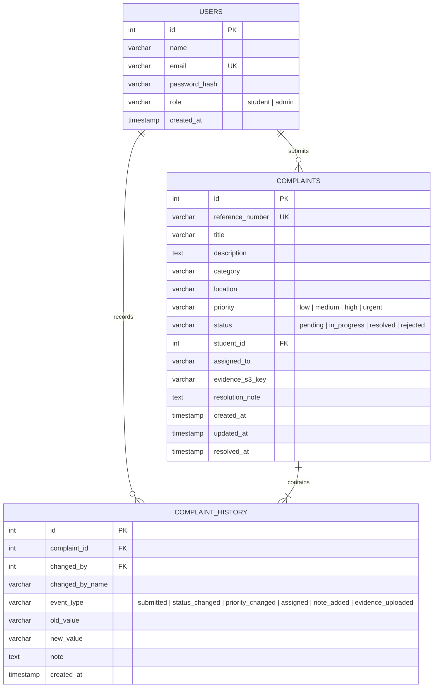

# FixMyCampus — Database Schema & Data Dictionary

## 1. Entity-Relationship Diagram (Mermaid)



---

## 2. Table Specifications

### 2.1 Table: `users`
Stores student and administrator user credentials and system roles.

| Column | Data Type | Constraints | Description |
| :--- | :--- | :--- | :--- |
| `id` | `SERIAL` | `PRIMARY KEY` | Auto-incrementing internal identifier. |
| `name` | `VARCHAR(120)` | `NOT NULL` | Full name of student or campus administrator. |
| `email` | `VARCHAR(255)` | `NOT NULL, UNIQUE` | Normalized lowercase campus email address. |
| `password_hash` | `VARCHAR(255)` | `NOT NULL` | bcrypt cryptographic hash (salt rounds >= 10). |
| `role` | `VARCHAR(20)` | `NOT NULL, CHECK (role IN ('student', 'admin'))` | System authorization role. |
| `created_at` | `TIMESTAMP WITH TIME ZONE` | `DEFAULT CURRENT_TIMESTAMP` | Account registration timestamp. |

* **Index**: `idx_users_email` on `(email)` for high-speed authentication lookup.

---

### 2.2 Table: `complaints`
Core entity representing reported infrastructure issues.

| Column | Data Type | Constraints | Description |
| :--- | :--- | :--- | :--- |
| `id` | `SERIAL` | `PRIMARY KEY` | Auto-incrementing internal primary key. |
| `reference_number`| `VARCHAR(30)` | `NOT NULL, UNIQUE` | Unique reference code (e.g. `FC-2026-0001`). |
| `title` | `VARCHAR(200)` | `NOT NULL` | Short summary of complaint. |
| `description` | `TEXT` | `NOT NULL` | Comprehensive details of the defect or hazard. |
| `category` | `VARCHAR(60)` | `NOT NULL, CHECK (category IN (...))` | One of 10 campus infrastructure categories. |
| `location` | `VARCHAR(150)` | `NOT NULL` | Specific campus building and room identifier. |
| `priority` | `VARCHAR(20)` | `NOT NULL, DEFAULT 'medium'` | Priority level (`low`, `medium`, `high`, `urgent`). |
| `status` | `VARCHAR(20)` | `NOT NULL, DEFAULT 'pending'` | Workflow state (`pending`, `in_progress`, `resolved`, `rejected`). |
| `student_id` | `INTEGER` | `NOT NULL, REFERENCES users(id)` | Foreign key identifying student submitter. |
| `assigned_to` | `VARCHAR(150)` | `DEFAULT NULL` | Name and role of assigned maintenance personnel. |
| `evidence_s3_key` | `VARCHAR(500)` | `DEFAULT NULL` | Object path in private Amazon S3 evidence bucket. |
| `resolution_note` | `TEXT` | `DEFAULT NULL` | Student-visible note detailing work done upon resolution. |
| `created_at` | `TIMESTAMP WITH TIME ZONE` | `DEFAULT CURRENT_TIMESTAMP` | Submission timestamp. |
| `updated_at` | `TIMESTAMP WITH TIME ZONE` | `DEFAULT CURRENT_TIMESTAMP` | Last modification timestamp. |
| `resolved_at` | `TIMESTAMP WITH TIME ZONE` | `DEFAULT NULL` | Timestamp when marked resolved (used for MTTR metrics). |

* **Indexes**:
  * `idx_complaints_student_id` on `(student_id)`: Enables fast lookup for "My Complaints".
  * `idx_complaints_status` on `(status)`: Accelerates dashboard status counters.
  * `idx_complaints_priority` on `(priority)`: Enables rapid high-priority triage filtering.
  * `idx_complaints_created_at` on `(created_at DESC)`: Optimizes timeline ordering.

---

### 2.3 Table: `complaint_history`
Immutable append-only audit trail recording every state change and administrative note.

| Column | Data Type | Constraints | Description |
| :--- | :--- | :--- | :--- |
| `id` | `SERIAL` | `PRIMARY KEY` | Auto-incrementing audit log identifier. |
| `complaint_id` | `INTEGER` | `NOT NULL, REFERENCES complaints(id) ON DELETE CASCADE` | Associated complaint identifier. |
| `changed_by` | `INTEGER` | `REFERENCES users(id) ON DELETE SET NULL` | User identifier who triggered the change. |
| `changed_by_name`| `VARCHAR(120)` | `NOT NULL` | Snapshot of actor's name for history display. |
| `event_type` | `VARCHAR(50)` | `NOT NULL, CHECK (event_type IN (...))` | Event classification (`submitted`, `status_changed`, etc.). |
| `old_value` | `VARCHAR(255)` | `DEFAULT NULL` | Previous value prior to modification. |
| `new_value` | `VARCHAR(255)` | `DEFAULT NULL` | New value following modification. |
| `note` | `TEXT` | `DEFAULT NULL` | Contextual note explaining reason for event. |
| `created_at` | `TIMESTAMP WITH TIME ZONE` | `DEFAULT CURRENT_TIMESTAMP` | Event timestamp. |

* **Indexes**:
  * `idx_history_complaint_id` on `(complaint_id)`: Fast retrieval for complaint timeline views.
  * `idx_history_created_at` on `(created_at ASC)`: Ensures strict chronological display.

---

## 3. Database Sequence: `complaint_ref_seq`
Sequential generator used to construct human-readable reference numbers:
```sql
CREATE SEQUENCE IF NOT EXISTS complaint_ref_seq START WITH 1;
-- Format: 'FC-' || EXTRACT(YEAR FROM CURRENT_DATE) || '-' || LPAD(nextval('complaint_ref_seq')::text, 4, '0')
-- Example Output: FC-2026-0001
```

## 4. Transaction Isolation & Consistency
Whenever a complaint status, priority, or assignment is updated, PostgreSQL `BEGIN ... COMMIT` transactions are strictly enforced. The update to `complaints` and the corresponding audit record in `complaint_history` succeed or fail as a single atomic unit.
