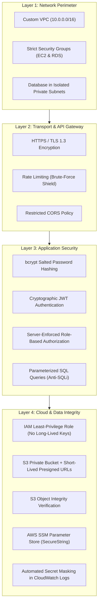

# FixMyCampus — Security Architecture & Threat Mitigation

This document details the multi-layered security controls implemented across the FixMyCampus application and AWS infrastructure.

---

## 1. Defense-in-Depth Summary



---

## 2. Authentication & Authorization

### 2.1 Password Security (bcrypt)
* Passwords are never stored in plaintext.
* Every password is processed with `bcryptjs` using **10 salt rounds**, producing a cryptographically random salt per user to prevent rainbow table attacks.
* Registration strictly enforces minimum password complexity (minimum 6 characters).

### 2.2 JWT Authentication Middleware
* Stateless, cryptographically signed JSON Web Tokens (JWT) are issued upon valid login.
* The backend verifies signature and expiration on every protected API call using `authenticateToken`.
* Secret key is stored in SSM Parameter Store (`SecureString`), never committed to source control.

### 2.3 Strict Server-Side Role Enforcement (RBAC)
* The browser client's state is **never trusted**.
* When a student submits a request, their identity (`student_id`) is extracted strictly from the verified JWT payload on the server.
* Students attempting to query or modify another student's complaint encounter a `403 Forbidden` response.
* Administrative endpoints (status update, priority change, technician assignment) are guarded by `requireRole(['admin'])`.

### 2.4 Prevention of Administrator Privilege Escalation
* The public registration endpoint (`POST /api/auth/register`) hardcodes `role: 'student'`. Any client attempting to send `role: 'admin'` in the body is ignored.
* Creation of an administrator account is restricted to the development-only CLI script (`createAdmin.js`), which explicitly refuses to run in production without manual environment flag override.

---

## 3. Data Storage & Query Security

### 3.1 Parameterized SQL Queries (Anti-SQL Injection)
All database interactions through `node-postgres` (`pg`) use parameterized placeholders (`$1, $2, ...`):
```javascript
// SECURE: Values are escaped by PostgreSQL protocol
await query('SELECT * FROM complaints WHERE student_id = $1 AND status = $2', [userId, status]);

// INSECURE (NEVER USED):
// await query(`SELECT * FROM complaints WHERE student_id = '${userId}'`);
```

### 3.2 Private S3 Bucket with Presigned URLs
* Public access to the S3 bucket is **100% blocked**.
* Students upload directly to S3 via temporary presigned PUT URLs valid for only **15 minutes**.
* The server dictates the S3 object key format (`evidence/student-{id}/{timestamp}-{random}.ext`), preventing directory traversal or path manipulation.
* Prior to linking an image to a complaint, `HeadObject` validates that the file exists and is authentic.
* Viewing evidence photographs requires a temporary presigned GET URL valid for only **30 minutes**.

---

## 4. Cloud Infrastructure Security

### 4.1 Least-Privilege IAM Instance Profile
* The EC2 instance accesses AWS APIs using an IAM Instance Profile (`FixMyCampusEC2InstanceRole`).
* **Zero AWS access keys or secret keys are saved on disk or in source code.**
* Permissions are strictly scoped to resources prefixed with `fixmycampus-*`. Administrator access (`AdministratorAccess` or `*.*`) is strictly prohibited.

### 4.2 Network Isolation (Private Subnets)
* The PostgreSQL database resides in private subnets (`10.0.10.0/24`, `10.0.11.0/24`) with **zero route to the Internet Gateway**.
* The RDS Security Group allows TCP port 5432 **only** from the EC2 Security Group ID. No external entity can reach port 5432 directly.

### 4.3 Log Masking
* The structured logger (`cloudwatchService.js`) automatically strips `password`, `token`, and `password_hash` fields from logs before streaming to Amazon CloudWatch.
